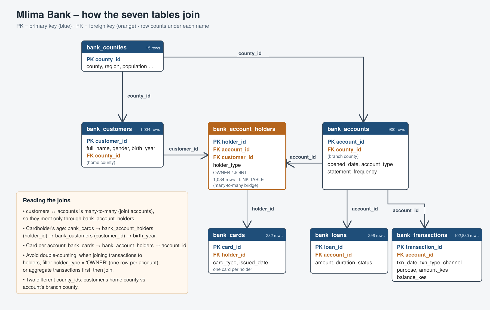
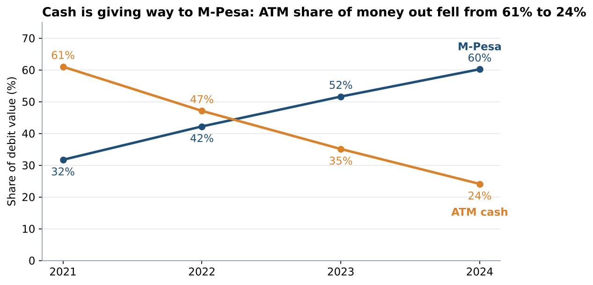
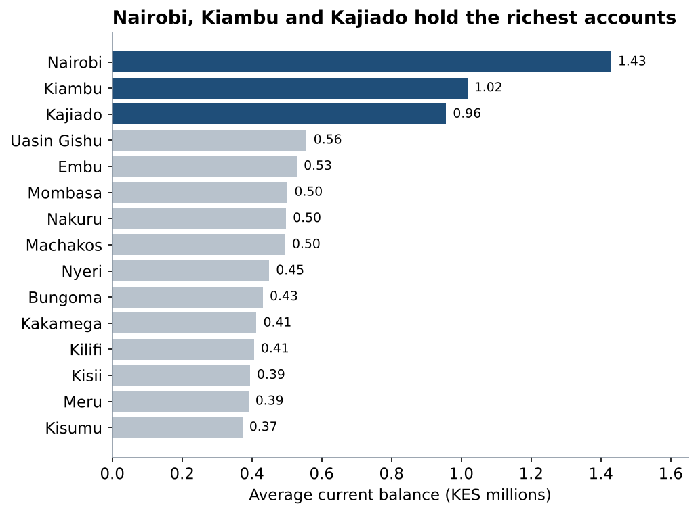
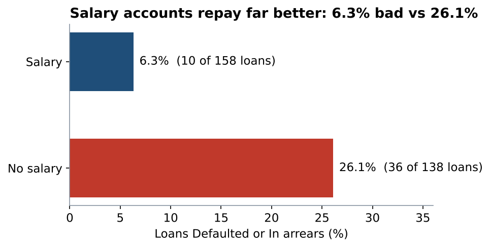
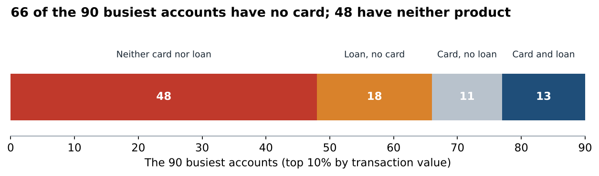
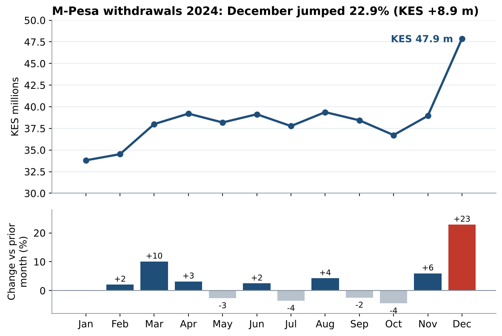

# Mlima Bank – Retail Banking SQL Analysis

SQL analysis of a (fictional) Kenyan retail bank's core-banking extract: seven tables covering 2021 to 2024. The goal is to find which customers are under-served by cards and loans, and where the bank should spend next year's cross-sell budget.

**Role:** Data Analyst, Retail Banking Insights · **Tools:** SQL (SQLite: CTEs, window functions `ROW_NUMBER`, `NTILE`, `LAG`), Python, matplotlib

> **Headline:** 66 of the 90 busiest accounts have no card and 48 have neither a card nor a loan. Loans on salary accounts go bad at 6.3%, against 26.1% without a salary.
> → Offer cards to the top 10% first and salary-backed loans second, starting in Nairobi and Kiambu.
> One-page summary: [`report/summary_for_head_of_retail.md`](report/summary_for_head_of_retail.md)

## Task 1 – Map the tables

Each CSV loads into a table named after its file (`bank-customers.csv` → `bank_customers`). See [`sql/schema.sql`](sql/schema.sql).

| Table | Rows | Key | Joins to |
|---|---:|---|---|
| bank_counties | 15 | county_id | bank_customers, bank_accounts |
| bank_customers | 1,034 | customer_id | bank_account_holders |
| bank_accounts | 900 | account_id | bank_account_holders, bank_transactions, bank_loans |
| bank_account_holders (link) | 1,034 | holder_id | bank_customers, bank_accounts, bank_cards |
| bank_transactions | 102,880 | transaction_id | bank_accounts |
| bank_loans | 296 | loan_id | bank_accounts |
| bank_cards | 232 | card_id | bank_account_holders |

- **Link table:** `bank_account_holders` connects customers and accounts. A `customer_id` can't sit on `bank_accounts` because the relationship is many-to-many: 134 accounts have a second (JOINT) holder, so one column could hold only one of them.
- **Cardholder age:** follow `bank_cards` → `bank_account_holders` (holder_id) → `bank_customers` (customer_id) → `birth_year`. Average age is 41.2 for Classic, 45.4 for Gold and 22.3 for Youth.
- **Counts:** 900 accounts, 1,034 customers, 296 loans and 232 cards.

## Task 2 – Describe the customer base

| Question | Answer |
|---|---|
| Most / fewest customers | **Nairobi 226** / **Kisii 26** |
| Joint accounts | **134** |
| Loans by status | Current **176** · Repaid **74** · In arrears **27** · Defaulted **19** |
| Accounts by type | Current 461 · Savings 314 · Business 125 (Monthly statements dominate: 658) |

## Task 3 – Follow the money

| Channel | Transactions | Total KES |
|---|---:|---:|
| **M-Pesa** | 40,292 | **2,219,887,290** |
| Bank transfer | 15,424 | 1,216,222,864 |
| ATM cash withdrawal | 15,930 | 773,290,500 |
| Branch | 7,668 | 563,910,051 |
| Standing order | 15,598 | 132,935,019 |
| Interest | 3,694 | 31,587,160 |
| Card POS | 4,274 | 13,683,530 |

- **Most money:** M-Pesa moves the most, KES 2.22 bn.
- **ATM share of debit value:** **61.0%** in 2021, down to **24.1%** in 2024. M-Pesa rose from 31.7% to 60.2% over the same years.
- **Busiest account:** account **2108**, with 286 transactions, owned by **Wanjiru Hassan** (Nairobi). The full top ten is in [`results/3e_ten_busiest_accounts.csv`](results/3e_ten_busiest_accounts.csv).

## Task 4 – Balances, salaries and risk

- **Highest average current balance:** **Nairobi KES 1.43 m**, **Kiambu 1.02 m** and **Kajiado 0.96 m**. The current balance is the balance on each account's latest transaction, picked with `ROW_NUMBER`.
- **Bad loans (Defaulted or In arrears):** **6.3%** for salary accounts (10 of 158) and **26.1%** for accounts with no salary (36 of 138). 379 accounts receive a salary.

## Task 5 – Find the cross-sell targets

- **Top 10% gaps:** of the 90 busiest accounts (`NTILE(10)` on total value), **66 have no card**, 59 have no loan and **48 have neither**. All 48 owners are named in [`results/5c_target_list_no_card_no_loan.csv`](results/5c_target_list_no_card_no_loan.csv); 23 are in Nairobi and 8 in Kiambu.
- **2024 M-Pesa jump:** withdrawals rose most in **December 2024**, by +KES 8.9 m (+22.9%) to KES 47.9 m. The likely cause is festive-season spending, gifts and travel upcountry. March (+10.1%) is the next largest rise.

- **Who gets a card first:** the busiest customers with no card. Those 66 top-decile accounts still made **282 ATM withdrawals worth KES 34.1 m in 2024**, money a card could move to POS. Today only card holders use POS: all 4,274 POS payments come from the 227 carded accounts.

### Recommendations

1. **Cards for the top 10% without one** (66 accounts): KES 34.1 m of 2024 ATM cash could move to card.
2. **Salary-backed loans for the 221 salary accounts with no loan**: their bad-loan rate is 6.3%, against 26.1% without a salary.
3. **A relationship-manager bundle (card + loan) for the 48 busiest accounts with neither**, starting in Nairobi (23) and Kiambu (8). These two counties also hold the highest balances.

---

## Assumptions

- **Salary account:** any account with at least one CREDIT whose `purpose = 'Salary'`.
- **Has a card:** any holder on the account (owner or joint) holds a card. Cards are mapped through `bank_account_holders`.
- **Total transaction value:** credits and debits summed.
- **Double-counting:** joins to people use `holder_type = 'OWNER'`, or aggregate transactions first, so joint accounts are not counted twice.

All query outputs are in [`results/RESULTS.md`](results/RESULTS.md).
